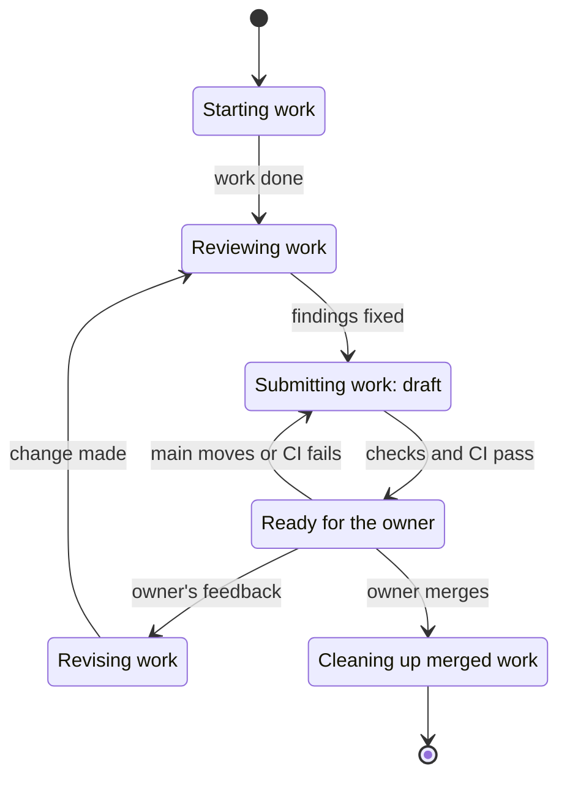

# Workflow

The procedures for a piece of work, in the order it moves through them. A piece of work is one branch, checked out in its own worktree and delivered as one pull request; [starting work](starting-work.md) says how it is set up.

The [engineering index](../README.md) points here rather than to each procedure. Read this index, then each procedure whose "Read when" matches.

## How work moves

A session that picks up work an earlier session left follows [resuming work](resuming-work.md), then carries on from the stage the work is in. The procedures own the rules for each step; the diagram only shows the order.

## Index

| Procedure                                             | Read when                                                                                                                                                                           |
| :---------------------------------------------------- | :---------------------------------------------------------------------------------------------------------------------------------------------------------------------------------- |
| [Starting work](starting-work.md)                     | Before starting work on a new branch                                                                                                                                                |
| [Resuming work](resuming-work.md)                     | Before continuing work on a branch that an earlier session started, including after the session's context was cleared                                                               |
| [Reviewing work](reviewing-work.md)                   | Before opening a pull request or pushing a revision, to review your own work; before reviewing someone else's pull request, or when asked to check one                              |
| [Submitting work](submitting-work.md)                 | Before opening a pull request, writing its description, or marking it ready; before pushing to a branch that has had a pull request; when `main` moves while a pull request is open |
| [Revising work](revising-work.md)                     | When the owner gives feedback on submitted work, in a review or in the session. Any request in the session that changes an open pull request is feedback, including an approval     |
| [Cleaning up merged work](cleaning-up-merged-work.md) | A pull request you worked on has been merged, before deleting any branch                                                                                                            |

## Adding a procedure

Follow [Adding a procedure](../README.md#adding-a-procedure) in the engineering index, with two differences: write the procedure as `docs/engineering/workflow/<verb>-work.md`, named for the stage of the work it covers, and add its row to the index above instead of the engineering index.

## Changing this document

The reasons for this index's layout are in [README.meta.md](README.meta.md). Read it only when changing or questioning it.
